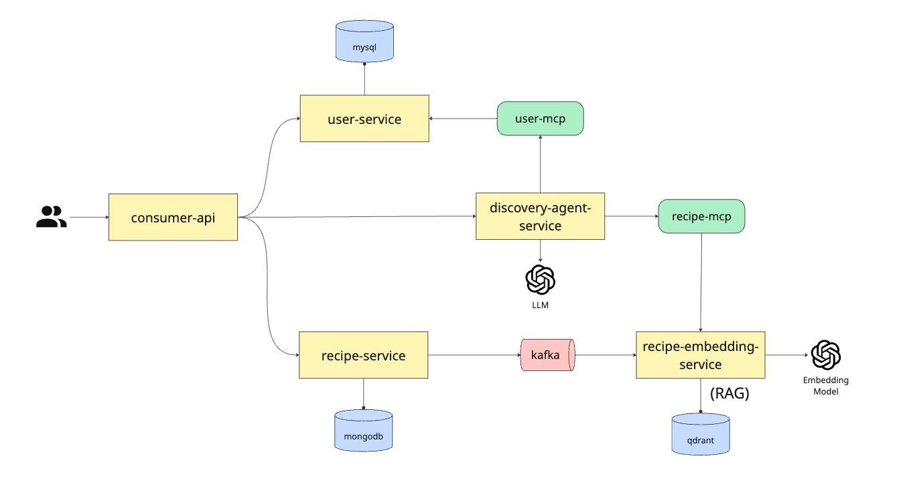

# Recipe Management App

This is a microservices-based recipe platform. Users sign up, log in, and manage recipes through a Next.js frontend, recipe events flow through Kafka into a vector store, and an LLM agent uses MCP tools to discover or invent recipes from a list of ingredients.

## Architecture



1. Users sign up, log in, and manage recipes through [frontend](frontend), which talks only to [consumer-api](consumer-api); `consumer-api` proxies requests to the internal services and issues/verifies the session's JWT.
2. Creating, updating or deleting a recipe in [recipe-service](recipe-service) publishes an event to the Kafka topic `recipe-log`, keyed by `recipe_id`. A delete publishes a tombstone (`value=None`).
3. [recipe-embedding-service](recipe-embedding-service) consumes that topic, embeds the recipe text with OpenAI (`text-embedding-3-large`), and upserts it into Qdrant.
4. For "find me something to cook" requests, [discovery-agent-service](discovery-agent-service) runs a LangChain agent (`gpt-4.1-mini`) that calls two MCP servers as tools:
   - [recipe-mcp-server](recipe-mcp-server) searches the user's existing recipes by ingredient similarity (via recipe-embedding-service).
   - [user-mcp-server](user-mcp-server) looks up the user's dietary preferences (via user-service).
- If no matching recipe exists, the agent invents one that fits the ingredients and the user's preferences instead of returning nothing.

## Services

| Service | Port | Responsibility | Storage / Dependencies |
|---|---|---|---|
| [frontend](frontend) | 3000 | Next.js app: signup/login, recipe list/create/view/edit/delete, profile, find-or-invent-a-recipe | consumer-api |
| [consumer-api](consumer-api) | 8088 | Public API gateway; password auth (signup/login) and session issuance; proxies to user, recipe, and discovery services | — |
| [user-service](user-service) | 8081 | User CRUD (profile, dietary restrictions, preferences) | MySQL |
| [recipe-service](recipe-service) | 8082 | Recipe CRUD; publishes create/update/delete events | MongoDB, Kafka (producer) |
| [recipe-embedding-service](recipe-embedding-service) | 8083 | Consumes recipe events, generates embeddings, similarity search | Kafka (consumer), Qdrant, OpenAI |
| [discovery-agent-service](discovery-agent-service) | 8084 | LLM agent that finds or invents a recipe from ingredients | OpenAI, MCP servers |
| [recipe-mcp-server](recipe-mcp-server) | 8085 | MCP tool wrapper: `get_recipe_by_ingredient` | recipe-embedding-service |
| [user-mcp-server](user-mcp-server) | 8086 | MCP tool wrapper: `get_user_by_id` | user-service |

- Each service has its own README with service-specific details.

### Infrastructure

| Component | Role |
|---|---|
| MySQL | User records (`recipe_user_db`) |
| MongoDB | Recipe documents |
| Kafka + Zookeeper | `recipe-log` event stream between recipe-service and recipe-embedding-service |
| Qdrant | Vector store for ingredient-similarity search |

## Tech Stack

- **Frontend:** Next.js (App Router) + TypeScript, Vitest for tests
- **Framework:** FastAPI + uvicorn
- **Validation:** Pydantic
- **Persistence:** SQLAlchemy + PyMySQL (users), Beanie over MongoDB (recipes), Qdrant (vectors)
- **Messaging:** Kafka via aiokafka
- **AI/Agents:** LangChain, LangGraph, `langchain-mcp-adapters`, OpenAI (`gpt-4.1-mini`, `text-embedding-3-large`)
- **MCP:** FastMCP (streamable-HTTP transport)
- **Packaging:** Docker / Docker Compose, one Dockerfile per service

## How To Run

### Prerequisites

- Docker and Docker Compose
- Python 3.12+ (only for running backend services outside Docker)
- Node.js 20+ (only for running the frontend outside Docker)
- An OpenAI API key (used by `recipe-embedding-service` and `discovery-agent-service`)
- A JWT signing secret (used by `consumer-api` to mint and verify Access Tokens; any sufficiently random string)

### Run With Docker

```bash
export OPENAI_API_KEY=sk-...
export JWT_SECRET_KEY=some-long-random-string
docker compose up --build
```

- This starts the infrastructure (MySQL, MongoDB, Kafka/Zookeeper, Qdrant) and all eight application services, including the frontend.
- Sign up and manage recipes at `http://localhost:3000`.
- All URLs and credentials are injected automatically from [docker-compose.yml](docker-compose.yml).

### Run Locally

- Start only the infrastructure containers:

```bash
docker compose up mysql mongodb kafka zookeeper qdrant
```

- Then, from a service directory:

```bash
python -m venv .venv && source .venv/bin/activate
pip install -r requirements.txt
uvicorn main:app --reload --port <service-port>   # or `python <name>-server.py` for the MCP servers
```

- Services read their downstream URLs from environment variables, set via a `.env` file in the service directory or exported in the shell. Most have `localhost`-based defaults.
- For the frontend, from [frontend](frontend):

```bash
npm install
npm run dev
```

- Defaults to talking to `consumer-api` at `http://localhost:8088`; override with `CONSUMER_API_URL` if it's running elsewhere. Serves the app at `http://localhost:3000`.
